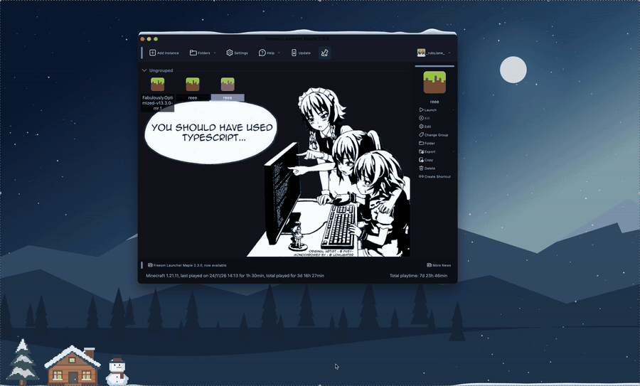

# Snowy Motion ❄️📳

**Tilt your MacBook and the snow slides. Shake it and snow falls off your windows.**



Snowy Motion is an unofficial fork of [Snowy](https://github.com/soloiaros/snowy-mac) by Yaroslav Solovev, based on Snowy 0.11.4. It keeps everything Snowy does and adds:

- **Tilt.** The MacBook's built-in motion sensor turns your desk into a slope: falling snow drifts toward the lower side and the snow on windows, the Dock and the bottom of the screen piles up there. Past about 12°, snow slides off the low edge of your windows. Tilts under about 3° are ignored.
- **Shake.** A shake knocks snow off window edges and flattens the piles. Typing and small bumps are ignored.
- **Closed windows drop their snow.** Close or minimize a window and its cap falls instead of vanishing.
- **Fast drags shed snow.** Fling a window and the snow on top lags behind and slides off the trailing edge; slow drags still carry it.
- **Smoother settling.** Piles settle every frame instead of in 0.1-second steps.

> Not affiliated with or endorsed by the Snowy project. Please report problems with these features here, not upstream.

## Install

Requires an Apple Silicon Mac with macOS 14 or later and Apple's Command Line Tools (the script offers to install them). Shake and tilt need a MacBook with the hidden motion sensor (see [Supported devices](#supported-devices)); everything else works on any Apple Silicon Mac.

```sh
git clone https://github.com/rubyjane-ai/snowy-motion.git
cd snowy-motion
zsh install-motion.sh   # app + shake & tilt (asks for your password once, then a 10-second calibration)
# or: zsh install.sh    # app only, no shake & tilt
```

The app installs as **Snowy Motion** next to the official Snowy and never updates over it. Keep only one of the two running.

### Supported devices

The snow itself runs on every Apple Silicon Mac with macOS 14 or later. Shake & tilt also need the MacBook's hidden motion sensor:

| Mac | Shake & tilt |
| --- | --- |
| MacBook Air with M2, M3, M4 or newer | ✅ Yes (confirmed on MacBook Air M3) |
| MacBook Pro with M2 or newer, including Pro and Max chips | ✅ Yes (confirmed on MacBook Pro M3 Pro by apple-silicon-accelerometer) |
| 14″ and 16″ MacBook Pro with M1 Pro or M1 Max | ✅ Expected (sensor present, not yet tested with Snowy Motion) |
| MacBook Air M1, 13″ MacBook Pro M1 | ❌ No motion sensor |
| MacBook Neo | ❌ Probably not: Apple lists it among the Macs without motion-based features |
| iMac, Mac mini, Mac Studio, Mac Pro | ❌ No (Mac Studio M4 Max confirmed without the sensor); the snow works, without shake & tilt |
| Intel Macs | ❌ Not supported (the app needs Apple Silicon) |

Not sure? Run this in Terminal. If it prints `"PrimaryUsage" = 3`, your Mac has the sensor:

```sh
ioreg -r -c AppleSPUHIDDevice | grep '"PrimaryUsage" = 3'
```

Tried it on a Mac that isn't confirmed yet? Please open an issue with your model so this table can be updated.

### How shake & tilt works

Apple doesn't expose the MacBook's motion sensor through any public API. It is reachable only as a raw HID device (`AppleSPUHIDDevice`) with administrator rights, so `install-motion.sh` installs a small helper, `snowy-motion`, as a LaunchDaemon. The helper reads the accelerometer, low-pass filters it into a tilt angle and a shake strength, and sends 60 small UDP packets a second to `127.0.0.1:47391`, where Snowy Motion picks them up. Nothing leaves your Mac. Without the helper the app behaves like Snowy.

- Check live readings: `sudo "/Library/Application Support/SnowyMotion/snowy-motion" --check`
- Recalibrate: `sudo "/Library/Application Support/SnowyMotion/snowy-motion" --calibrate`
- Remove the helper: `zsh uninstall-motion.sh`

The sensor is undocumented, so a macOS update could change or block it.

## Credits

- [Snowy](https://github.com/soloiaros/snowy-mac) by Yaroslav Solovev, MIT License: the app this fork is built on.
- [apple-silicon-accelerometer](https://github.com/olvvier/apple-silicon-accelerometer) by olvvier, MIT License: how to find, wake and decode the motion sensor.
- The fork's changes were written with the help of Claude (Anthropic).

---

*The original Snowy README follows.*

# Snowy ❄️

Snow for your desktop. A native Mac app that lets winter settle on your windows, widgets, and bottom Dock.

Sweep a pile with your pointer. Pick up a shovel. Make a little mess.


## Get it

Download the latest [Apple Silicon DMG](https://github.com/soloiaros/snowy-mac/releases/latest/download/Snowy-macOS-arm64.dmg), open it, and drag **Snowy.app** onto **Applications**. Eject the disk image, then open Snowy from Applications. On a fresh setup, three quick pages show how to sweep snow, adjust wind, and find the menu-bar controls. Skip or close the walkthrough at any time; it won’t reopen on later launches.

Requires **macOS 14 or later**. The current download is for Apple Silicon. Intel Macs can build from source. The 0.10.0 beta is signed locally and can trigger Gatekeeper’s malware-verification warning. If macOS blocks the copy you downloaded here, go to **System Settings → Privacy & Security → Open Anyway** after trying to open it.

When a compatible release is available, **Update** appears in blue near the bottom of the snowflake menu. Click it to download, install, and reopen Snowy. To upgrade from 0.9.1 or earlier, quit Snowy and replace it in Applications using the DMG once.

## Let it snow

Click the snowflake in your menu bar to make yourself comfortable:

- Choose **Light**, **Steady**, or **Flurry**.
- Brush snow away with the **Glove**, or choose **Shovel** for a proper clear-out.
- Open **Wind…** and stretch or rotate the arrow to change its strength and direction.
- **Pause** the weather or **Clear Settled Snow** whenever you like.

Snow collects on window tops, widgets, Spotlight, and a bottom-positioned Dock. Moving windows push it around; closing Spotlight lets its uncovered snow fall. Side-positioned Docks are intentionally left out.

Choose **Open Snowy…** in the snowflake menu to apply a wallpaper, select a pixel-art preset, or build your own desktop scene. Props catch snow and can slide when swept. In **Edit Scene**, place individual pieces and attach string lights to the desktop edges and widgets. Finder icon anchors are optional and require Accessibility access. The **Guide** includes **Replay Walkthrough**.

The desktop stays clickable. Snowy reads public window bounds for snow and widgets. Finder icon anchors use Accessibility only when enabled. Snowy keeps your settings and imported wallpapers on your Mac and checks GitHub for signed updates.

## Build it yourself

You’ll need **Xcode 16 or later**, its Metal toolchain, and a Mac.

```sh
git clone https://github.com/soloiaros/snowy-mac.git
cd snowy-mac
./scripts/build-app.sh
open build/Snowy.app
```

The build script compiles the app and shaders, adds a local signature, and leaves the app in `build/`. It does not launch or install anything. If Xcode reports a missing Metal toolchain, install it from Xcode’s component settings first.

## Windows 11 beta

Choose [Windows Beta](https://snowy.aauburn.com/#download-windows) for x64 or ARM64. Open the setup file and follow the installer. Snowy lives in the system tray near the clock. The beta is unsigned, so Windows SmartScreen may warn or block it. [Windows build and update instructions](windows/README.md)

## A desktop in your browser

The [website](https://snowy.aauburn.com) has its own movable windows, a bottom Dock, and snow you can push around. There may also be someone thawing out for December. All downloads are pay what you want, including $0. Optional support uses [Polar hosted checkout](website/docs/payments.md).

Run it locally with **Node.js 22 or later**. No packages need installing.

```sh
npm --prefix website run dev
```

Open the address printed by the server. To make the static site, run `npm --prefix website run build`; the result goes into `website/dist/`. See the [Cloudflare deployment guide](website/docs/deployment.md) to publish it.

## A few rough edges

Window corners and some Dock bounds are estimates because macOS doesn’t expose every visible outline. Custom window shapes and system updates can need adjustments. The app has bounded simulation and rendering budgets, respects Low Power Mode and Reduced Motion, and pauses for sleep or fullscreen content. These are design choices, not a battery-life claim.

If something behaves oddly, [open an issue](https://github.com/soloiaros/snowy-mac/issues) with your macOS version, screen setup, Dock position, and steps to reproduce it.

## Contributing

```sh
swift test
npm --prefix website ci --ignore-scripts
npm --prefix website test
npm --prefix website run build
```

The tests run headlessly. They don’t open the app, inspect your desktop, or run benchmarks. See [CONTRIBUTING.md](CONTRIBUTING.md) for the project layout and release steps, and [the architecture notes](docs/architecture.md) for the physics and resource limits.

## Credits and license

The readable, personal repository style was inspired by [Window Sweaters](https://github.com/saragordic/window-sweaters). Snowy has its own implementation and artwork; it does not include Window Sweaters or JankyBorders code.

Code and original artwork use the [MIT license](LICENSE). The user-provided sound clip is excluded from that license.
